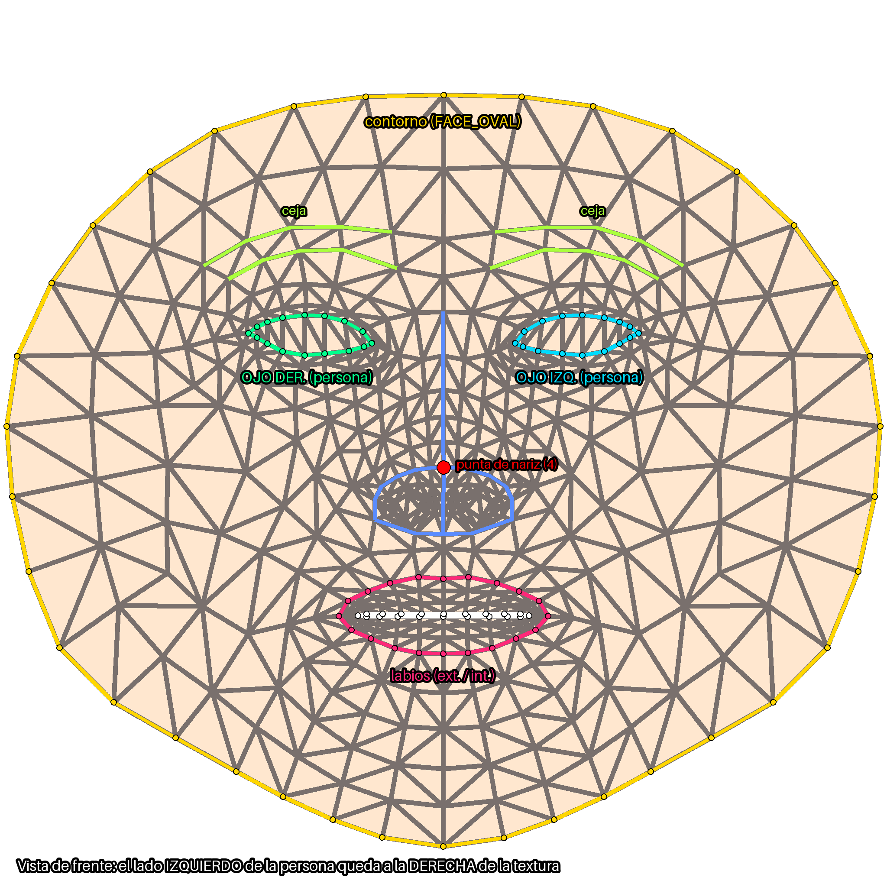
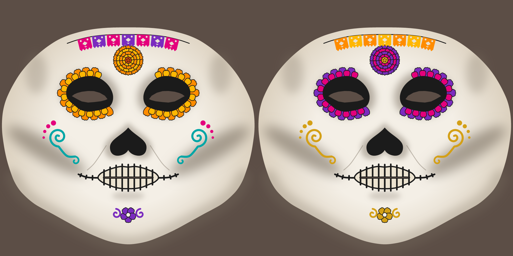

# Calavera AR 💀🌼

Filtro facial web para celular: al abrir la página se activa la cámara frontal y el rostro
se cubre con una **calavera de Día de Muertos** pintada sobre la malla facial, como si fuera
maquillaje. Los elementos del diseño están anclados a los landmarks de ojos, nariz, boca y
contorno, así que la máscara se estira con los gestos sin desprenderse.

Actividad 3 del curso de Realidad Virtual y Aumentada: _Máscara de Día de Muertos con mapeo
facial de precisión_. Parte del filtro de la Actividad 2 (Máscara de Lava AR).

> 🚧 En desarrollo. Las fases y su avance están en [SPEC_ACT3.md](SPEC_ACT3.md).

## Cómo se usa

| Gesto | Efecto |
|---|---|
| **Abrir la boca** | Lluvia de pétalos de cempasúchil 🌼 |
| **Levantar las cejas** | Cambio de paleta de la calavera 🎨 |

Parámetros de URL para revisión:
- `?template=1`: muestra la plantilla UV sobre la cara.
- `?guide=1`: muestra la guía con los contornos de ojos, labios, nariz y cara.
- `?debug=1`: puntos de los landmarks, valores de los blendshapes y teclas `B` (pétalos) y
  `P` (paleta) para disparar los efectos sin hacer el gesto.

## Proceso de la textura

Plantilla UV → guía de rasgos → SVG anclado a landmarks → rasterizado → vista previa 3D.

| Paso | Script | Salida |
|---|---|---|
| 1. Plantilla UV | `tools/01_uv_template.py` (Blender) | `assets/face/uv_template.png` |
| 2. Guía de rasgos | `tools/02_uv_guide.py` | `assets/face/uv_guide.png` |
| 3. Diseño SVG | `tools/03_generate_svg.py` | `design/calavera.svg`, `design/calavera_alt.svg` |
| 4. Rasterizado | `tools/04_rasterize.py` _(Fase 3)_ | `assets/mask/calavera.png`, `calavera_alt.png` |
| 5. Vista previa 3D | `tools/05_preview_blender.py` _(Fase 3)_ | `docs/screenshots/` |

Los contornos de los rasgos salen de los conjuntos oficiales de conexiones de MediaPipe
(`FaceLandmarksConnections`), no de índices escritos a mano. El SVG está organizado en capas
con nombre (`base`, `frente`, `mejillas`, `menton`, `nariz`, `boca`, `ojos`,
`transparencias`) para retocarlo en Inkscape, Figma o Illustrator.




## Ejecución local

El filtro no tiene dependencias; basta con servir la carpeta:

```bash
python -m http.server 8000
```

Abre `http://localhost:8000` (en `localhost` la cámara funciona sin HTTPS). Para el celular
se necesita HTTPS (el enlace publicado).

### Regenerar la textura

Requisitos: Blender 4.x y Python 3.10+ con `pip install -r tools/requirements.txt`.

```bash
blender --background --factory-startup --python tools/01_uv_template.py
python tools/02_uv_guide.py
python tools/03_generate_svg.py
```

Si `blender` no está en el PATH, usa la ruta completa
(Windows: `"C:\Program Files\Blender Foundation\Blender 4.3\blender.exe"`).

## Estructura

```
index.html, css/style.css
js/
  main.js       arranque: cámara, MediaPipe, render loop, UI y modo debug
  config.js     constantes ajustables (texturas, gestos, efectos)
  face.js       MediaPipe: landmarks y blendshapes (GPU con respaldo a CPU)
  scene.js      cámara ortográfica alineada al video (espejo + object-fit: cover)
  mask.js       malla facial + shader que mezcla las dos paletas
  gestures.js   gestos con umbral, pausa e histéresis
  effects.js    pétalos y cambio de paleta
  audio.js      sonidos
assets/         malla canónica, plantilla y guía UV, texturas de la máscara
design/         diseño fuente en SVG (editable a mano)
tools/          scripts de la textura
docs/           imágenes del README
```

## Créditos y licencias

| Recurso | Fuente | Licencia |
|---|---|---|
| Malla canónica y modelo Face Landmarker | [MediaPipe](https://github.com/google-ai-edge/mediapipe) (Google) | Apache 2.0 |
| three.js | [threejs.org](https://threejs.org/) | MIT |
| Diseño de la calavera | Propio | Propio |

## Autor

_NOMBRE(S) DEL EQUIPO_
